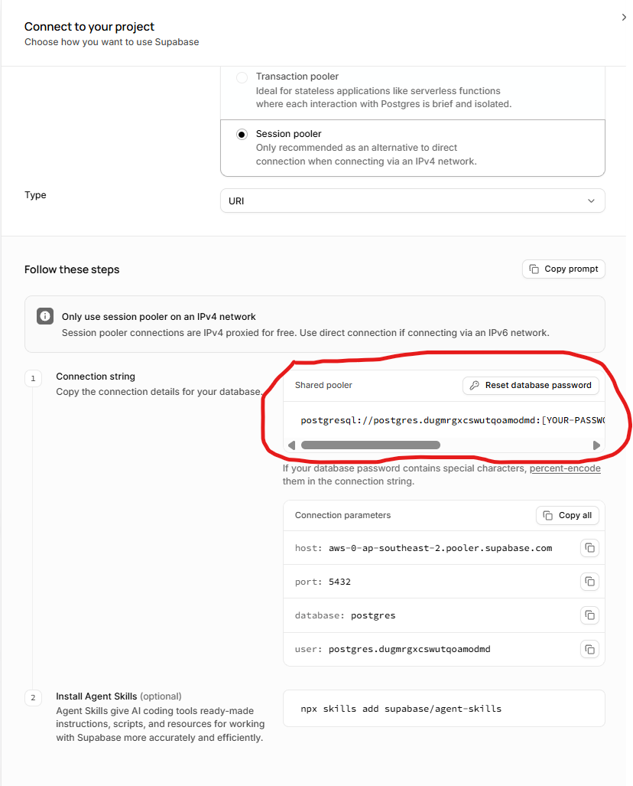

# Flask REST API: Studi Kasus MBG

Contoh REST API sederhana berdasarkan studi kasus MBG.
Stack: **Flask · SQLAlchemy (ORM) · Supabase (PostgreSQL) · JWT Authentication**.

## Struktur Project

```
flask_api/
├── app/
│   ├── __init__.py          # berisi initialize app Flask
│   ├── config.py            # konfigurasi dari .env
│   ├── extensions.py        # initialize object db (SQLAlchemy) & jwt
│   ├── errors.py            # error handler -> untuk daftar respons JSON
│   ├── cli.py               # untuk menjembatani perintah cli: create-admin
│   ├── models/              # 1 file untuk 1 tabel
│   ├── routes/              # 1 file = 1 Blueprint untuk tiap endpoint
│   └── utils/               # validators, helpers, auth, responses, errors
|   └── doc/api.md           # Contoh dokumentasi API
├── run.py
├── skema_users.sql          # struktur tabel users yang mungkin belum kalian tambahkan
├── requirements.txt         # daftar library eksternal/dependencies yang dibutuhkan project untuk berjalan 
└── .env.example             # template file .env
```

## Cara Menjalankan

```bash
python -m venv venv
source venv/bin/activate            # Windows: venv\Scripts\activate
pip install -r requirements.txt
cp .env.example .env                # lalu isi DATABASE_URL & JWT_SECRET_KEY
```

1. Jalankan `skema_database.sql` lalu `skema_users.sql` di Supabase (SQL Editor).
2. Buat akun admin pertama:
  *pastikan table user sudah dibuat di schema embegeh (cek file skema_users.sql)
   ```bash
   flask --app run create-admin
   ```
3. Jalankan server: `python run.py` atau `flask run`
4. Jalankan tes: `pytest -v`

### Cara Mendapatkan DATABASE_URL

1. Masuk ke dashboard project database kalian
2. Klik button *Connect*
3. Masuk ke tab *Direct Connection String*
4. Pada section *Connection Method* pilih *Session Pooler*
5. Pada section *Type* set ke *URI*
6. Pada bagian *Connection String* > *Shared Pooler* > Copy URL postgresql://..... 

**Catatan: pada modul praktik Supabase sebelumnya kita menggunakan password database: "67MbG_73447Xpr4b0w0"**

## Aturan Akses

| Level | Siapa | Endpoint |
|-------|-------|----------|
| Publik | siapa saja | `GET` pada `sekolah`, `sppg`, `menu`, `produksi`, `/auth/register`, `/auth/login` |
| Login | role `viewer` atau `admin` | `GET /keracunan`, `GET /auth/me` |
| Admin | role `admin` | semua `POST`, `PUT`, `PATCH`, `DELETE` |

Registrasi publik selalu menghasilkan role `viewer`. Admin hanya dibuat lewat CLI.

## Daftar Endpoint

| Method | Path | Keterangan |
|--------|------|-----------|
| POST | `/auth/register` | Daftar akun (viewer) |
| POST | `/auth/login` | Dapatkan access token |
| GET | `/auth/me` | Profil dari token |
| GET | `/{sekolah,sppg,menu,produksi,keracunan}` | Daftar (pagination + filter) |
| GET | `/{resource}/<id>` | Detail |
| POST | `/{resource}` | Tambah |
| PUT | `/{resource}/<id>` | Ganti penuh (semua field wajib dikirim) |
| PATCH | `/{resource}/<id>` | Ubah sebagian |
| DELETE | `/{resource}/<id>` | Hapus |
| GET | `/sppg/<id>/menu` | Menu milik satu SPPG |
| GET | `/sekolah/<id>/keracunan` | Riwayat keracunan satu sekolah |

**Pagination:** `?page=1&per_page=10` (maks 100)

**Filter:** `sekolah` (`jenjang`, `q`), `sppg` (`status_operasional`, `id_sekolah`),
`menu` (`rasa`, `id_sppg`, `is_halal`), `produksi` (`status_qc`, `id_sppg`, `id_menu`),
`keracunan` (`tingkat_keparahan`, `id_sekolah`, `id_sppg`)

## Format Respons

```json
{ "status": "success", "message": "...", "data": { }, "meta": { "page": 1, "per_page": 10, "total": 25, "pages": 3 } }
{ "status": "error", "message": "Validasi gagal", "errors": { "jumlah_siswa": "minimal 1" } }
```

| Kode | Arti |
|------|------|
| 200 / 201 | Berhasil / berhasil dibuat |
| 400 | Body bukan JSON object |
| 401 | Token tidak ada, salah, atau kedaluwarsa / login gagal |
| 403 | Login, tapi role tidak punya izin |
| 404 | Data tidak ditemukan |
| 409 | Duplikat / melanggar constraint database |
| 422 | Validasi input gagal |

Untuk **Postman**: buat request `POST /auth/login`, salin `access_token`, lalu pada tab
*Authorization* pilih tipe *Bearer Token* di request lain.

## Konsep yang Dibahas di Tiap File

| File | Konsep |
|------|--------|
| `extensions.py`, `__init__.py` | Application factory, extension pattern |
| `models/*.py` | ORM mapping, tipe kolom, foreign key, enum PostgreSQL, `server_default` |
| `utils/validators.py` | Validasi manual, whitelist field (mencegah mass assignment) |
| `routes/sekolah.py` | CRUD lengkap, PUT vs PATCH, pagination, filter, Blueprint |
| `routes/auth.py` | Hash password, JWT, claims role, pesan login yang tidak membocorkan info |
| `utils/auth.py` | Decorator otorisasi berbasis role |
| `errors.py` | Error handler terpusat, kode status HTTP |