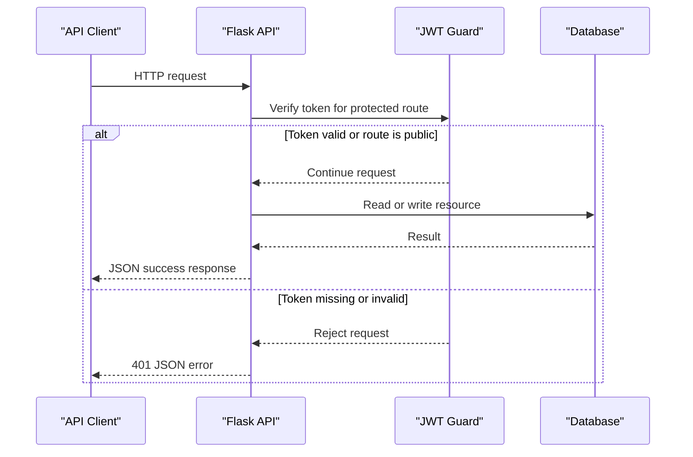

# Dokumentasi REST API

Dokumentasi ini merangkum route yang terdaftar pada aplikasi, kontrak request/response, autentikasi, dan hasil pengujian deployment.

## Informasi Umum

| Properti | Nilai |
|---|---|
| Base URL deployment | `https://flask-restapi.vercel.app` |
| Format payload | JSON |
| Content-Type request | `application/json` |
| Format respons | JSON dengan properti `status`, dan lain sebagainya seperti `message`, `data`, `meta`, atau `errors` |


## Autentikasi dan Otorisasi

API menggunakan autentikasi access token JWT. Pastikan kirim token pada header `Authorization` dengan skema Bearer:

```http
Authorization: Bearer <access_token>
```

- Registrasi akan otomatis membuat akun dengan role `viewer`.
- `GET /auth/me` dan endpoint baca `/keracunan` memerlukan token valid.
- Endpoint pembuatan, perubahan, dan penghapusan data memerlukan token dengan role `admin`.
- Pengguna `viewer` tidak dapat melakukan operasi write pada endpoint yang dilindungi role admin.

Token diberikan lewat `POST /auth/login`. Token harus disertakan pada semua endpoint yang ditandai **Bearer** atau **Admin** pada list inventaris di bawah.

## Inventaris Endpoint

Terdapat 37 kombinasi HTTP method dan path..

| Method | Path | Request | Sukses | Akses |
|---|---|---|---|---|
| `GET` | `/` | — | `200` | Publik |
| `GET` | `/db-check` | — | `200` jika DB tersedia | Publik |
| `POST` | `/auth/register` | JSON registrasi | `201` | Publik |
| `POST` | `/auth/login` | JSON kredensial | `200` | Publik |
| `GET` | `/auth/me` | — | `200` | Bearer |
| `GET` | `/sekolah` | Query filter dan pagination opsional | `200` | Publik |
| `GET` | `/sekolah/{id}` | ID sekolah | `200` | Publik |
| `GET` | `/sekolah/{id}/keracunan` | ID sekolah dan pagination opsional | `200` | Publik |
| `POST` | `/sekolah` | JSON sekolah | `201` | Admin |
| `PUT`, `PATCH` | `/sekolah/{id}` | JSON perubahan sekolah | `200` | Admin |
| `DELETE` | `/sekolah/{id}` | ID sekolah | `200` | Admin |
| `GET` | `/sppg` | Query filter dan pagination opsional | `200` | Publik |
| `GET` | `/sppg/{id}` | ID SPPG | `200` | Publik |
| `GET` | `/sppg/{id}/menu` | ID SPPG dan pagination opsional | `200` | Publik |
| `POST` | `/sppg` | JSON SPPG | `201` | Admin |
| `PUT`, `PATCH` | `/sppg/{id}` | JSON perubahan SPPG | `200` | Admin |
| `DELETE` | `/sppg/{id}` | ID SPPG | `200` | Admin |
| `GET` | `/menu` | Query filter dan pagination opsional | `200` | Publik |
| `GET` | `/menu/{id}` | ID menu | `200` | Publik |
| `POST` | `/menu` | JSON menu | `201` | Admin |
| `PUT`, `PATCH` | `/menu/{id}` | JSON perubahan menu | `200` | Admin |
| `DELETE` | `/menu/{id}` | ID menu | `200` | Admin |
| `GET` | `/produksi` | Query filter dan pagination opsional | `200` | Publik |
| `GET` | `/produksi/{id}` | ID produksi | `200` | Publik |
| `POST` | `/produksi` | JSON produksi | `201` | Admin |
| `PUT`, `PATCH` | `/produksi/{id}` | JSON perubahan produksi | `200` | Admin |
| `DELETE` | `/produksi/{id}` | ID produksi | `200` | Admin |
| `GET` | `/keracunan` | Query filter dan pagination opsional | `200` | Bearer |
| `GET` | `/keracunan/{id}` | ID data keracunan | `200` | Bearer |
| `POST` | `/keracunan` | JSON data keracunan | `201` | Admin |
| `PUT`, `PATCH` | `/keracunan/{id}` | JSON perubahan data keracunan | `200` | Admin |
| `DELETE` | `/keracunan/{id}` | ID data keracunan | `200` | Admin |

`PUT` dan `PATCH` keduanya menerima perubahan parsial. Untuk `PATCH`, field wajib pada created_at boleh tidak dikirim.

## Parameter Query

### Pagination

Semua endpoint daftar mendukung:

| Parameter | Default | Batas |
|---|---:|---|
| `page` | `1` | Nilai di bawah `1` disesuaikan menjadi `1` |
| `per_page` | `10` | Minimum `1`, maksimum `100` |

Contoh:

```http
GET /menu?page=1&per_page=20
```

Respons daftar berisi `data` berupa array dan `meta` berisi nomor halaman serta total:

```json
{
  "status": "success",
  "data": [],
  "meta": {
    "page": 1,
    "per_page": 10,
    "total": 0,
    "pages": 0
  }
}
```

### Filter per resource

| Endpoint | Parameter | Keterangan |
|---|---|---|
| `/sekolah` | `jenjang` | Salah satu dari `SD`, `SMP`, `SMA`, `SMK` |
| `/sekolah` | `q` | Pencarian substring pada nama sekolah |
| `/sppg` | `status_operasional` | Salah satu dari `Aktif`, `Nonaktif`, `Dalam Investigasi` |
| `/sppg` | `id_sekolah` | Filter berdasarkan ID sekolah |
| `/menu` | `rasa` | Salah satu dari `Gurih`, `Manis`, `Pedas`, `Asam`, `Netral` |
| `/menu` | `id_sppg` | ID SPPG positif |
| `/menu` | `is_halal` | String `true` atau `false` |
| `/produksi` | `status_qc` | Salah satu dari `Lolos`, `Gagal`, `Karantina` |
| `/produksi` | `id_sppg`, `id_menu` | Filter berdasarkan ID terkait |
| `/keracunan` | `tingkat_keparahan` | Salah satu dari `Ringan`, `Sedang`, `Berat` |
| `/keracunan` | `id_sekolah`, `id_sppg` | Filter berdasarkan ID terkait |

Filter pilihan yang tidak valid ditolak dengan `422`. Validasi nilai ID query tidak seragam antar-resource: `/menu?id_sppg=...` menolak ID non-positif/tidak bulat dengan `422`, sementara beberapa filter ID resource lain dikonversi menggunakan parser Flask dan dapat diabaikan jika bukan bilangan bulat.

## Kontrak Request

Field di bawah adalah field yang diterima oleh validasi route. Field yang disebut opsional dapat tidak dikirim atau bernilai `null` bila bukan field wajib. Field di luar daftar validasi diabaikan.

### Registrasi dan login

`POST /auth/register`:

```json
{
  "username": "contoh_user",
  "email": "user@example.com",
  "password": "contoh-password-kuat"
}
```

Semua field wajib. Username memiliki panjang 3–50 karakter, password 8–100 karakter, dan format email harus benar. Username atau email yang telah digunakan akan menghasilkan response `409`. Kemudian Role akun baru selalu di-set ke `viewer`.

`POST /auth/login`:

```json
{
  "username": "contoh_user",
  "password": "contoh-password-kuat"
}
```

Kedua field wajib. Kredensial yang salah menghasilkan `401`.

### Sekolah

`POST /sekolah`:

- Wajib: `nama_sekolah` (teks), `jumlah_siswa` (integer minimal 1), `alamat_sekolah` (teks).
- Opsional: `jenjang` (`SD`, `SMP`, `SMA`, `SMK`), `email_sekolah`, `nomor_telepon`.

### SPPG

`POST /sppg`:

- Wajib: `nama_sppg` (teks), `alamat` (teks), `jumlah_karyawan` (integer minimal 0).
- Opsional: `id_sekolah`, `kapasitas_produksi_harian` (integer minimal 1), `nomor_izin_edar`, `status_operasional` (`Aktif`, `Nonaktif`, `Dalam Investigasi`), `penanggung_jawab`.

### Menu

`POST /menu`:

- Wajib: `nama_menu` (teks), `id_sppg` (integer).
- Opsional: `rasa` (`Gurih`, `Manis`, `Pedas`, `Asam`, `Netral`), `id_produksi`, `kalori_kcal` (integer minimal 1), `biaya_per_porsi` (angka 0–99.999.999), `is_halal` (boolean JSON), `kategori_gizi`.

### Produksi

`POST /produksi`:

- Wajib: `batch_produksi` (integer minimal 1), `id_sppg` (integer), `id_menu` (integer), `jumlah_porsi` (integer minimal 1).
- Opsional: `waktu_produksi` (tanggal `YYYY-MM-DD`), `status_qc` (`Lolos`, `Gagal`, `Karantina`), `suhu_simpan_celsius` (angka -20 sampai 100), `waktu_distribusi` (datetime ISO 8601).

### Data keracunan

`POST /keracunan`:

- Wajib: `id_sekolah` (integer), `id_sppg` (integer), `jumlah_siswa` (integer minimal 0), `waktu_kejadian` (datetime ISO 8601).
- Opsional: `tingkat_keparahan` (`Ringan`, `Sedang`, `Berat`), `gejala_dominan`, `status_penanganan`, `catatan_medis`.
- Endpoint tulis memerlukan role `admin`; `GET /keracunan` dan `GET /keracunan/{id}` memerlukan token.

Format waktu ISO 8601 dapat menyertakan zona waktu, misalnya `2026-10-11T08:30:00+07:00`.

## Format Respons dan Error

Respons sukses mengikuti format umum berikut:

```json
{
  "status": "success",
  "message": "Operasi berhasil",
  "data": {
    "id": 123
  }
}
```

atribut `message` tidak selalu ada.
Respons daftar menggunakan array pada `data` dan objek pagination pada `meta`. Di mana respons hapus hanya berisi `status` dan `message`. Kemudian Timestamp diserialisasi sebagai ISO 8601; nilai desimal dikembalikan sebagai angka JSON.

Respons error:

```json
{
  "status": "error",
  "message": "Validasi gagal",
  "errors": {
    "nama_menu": "wajib diisi"
  }
}
```

`errors` hanya disertakan bila ada rincian validasi.

| HTTP status | Makna |
|---:|---|
| `400` | Body bukan JSON object atau request tidak valid |
| `401` | Token tidak ada, tidak valid/kedaluwarsa, atau kredensial login salah |
| `403` | Token valid tetapi role tidak memiliki izin |
| `404` | Resource tidak ditemukan |
| `409` | Data duplikat atau melanggar constraint database |
| `422` | Validasi payload, relasi, atau filter gagal |
| `500` | Kegagalan server, termasuk pemeriksaan koneksi database |

## Contoh Penggunaan

### Daftar menu dengan pagination

```bash
curl "https://flask-restapi.vercel.app/menu?page=1&per_page=10"
```

### Registrasi dan login

```bash
curl -X POST "https://flask-restapi.vercel.app/auth/register" \
  -H "Content-Type: application/json" \
  -d '{"username":"contoh_user","email":"user@example.com","password":"contoh-password-kuat"}'

curl -X POST "https://flask-restapi.vercel.app/auth/login" \
  -H "Content-Type: application/json" \
  -d '{"username":"contoh_user","password":"contoh-password-kuat"}'
```

### Membaca identitas pengguna

```bash
curl "https://flask-restapi.vercel.app/auth/me" \
  -H "Authorization: Bearer <access_token>"
```

### Membuat data dengan token admin

```bash
curl -X POST "https://flask-restapi.vercel.app/menu" \
  -H "Authorization: Bearer <admin_access_token>" \
  -H "Content-Type: application/json" \
  -d '{"nama_menu":"Menu Contoh","id_sppg":1,"rasa":"Gurih","is_halal":true}'
```


## Alur Request

Diagram berikut menunjukkan alur umum request baca dan pemeriksaan autentikasi untuk resource yang dilindungi.

<!-- mermaid-checked: every participant uses `participant Id as "Label"`, no \n in aliases/messages/notes, every alt/opt/loop closed by end, no `:` inside any alias -->


## Hasil Pengujian


| Pemeriksaan | Hasil |
|---|---|
| `GET /` | `200`; pesan sambutan API berhasil diterima |
| `GET /db-check` | `200`; database terhubung |
| `GET /sekolah`, `/sppg`, `/menu`, `/produksi` | `200`; respons berbentuk paginasi |
| `GET /sppg/1/menu?page=1&per_page=1` | `200`; pagination/filter relasi berfungsi |
| `GET /sekolah?q=nonexistent-schools-query` | `200`; daftar kosong dan `meta.total` bernilai `0` |
| `GET /menu?page=0&per_page=999` | `200`; nilai pagination dibatasi menjadi page `1`, per-page `100` |
| `GET /sekolah?jenjang=invalid` | `422`; error validasi filter sesuai format JSON |
| `GET /sekolah/999999` | `404`; error resource tidak ditemukan sesuai format JSON |
| `GET /auth/me`, `GET /keracunan` tanpa token | `401`; akses terlindungi ditolak |
| `POST /menu` tanpa token | `401`; operasi admin ditolak sebelum perubahan data |
| `POST /auth/register` tanpa body JSON | `400`; body request divalidasi dan tidak membuat akun |
| `tests/test_menu.py` | `4 passed` |